
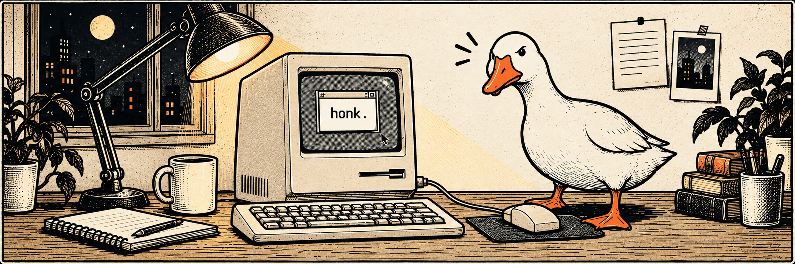

# miko 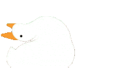

Apps, tools, and side projects.

<picture><source media="(prefers-color-scheme: dark)" srcset="./assets/icons/aligned/map-contact-dark.svg">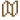</picture> Astana, Kazakhstan &nbsp; · &nbsp; <picture><source media="(prefers-color-scheme: dark)" srcset="./assets/icons/aligned/message-contact-dark.svg"></picture> <a href="https://t.me/mikonyaa">Telegram</a> &nbsp; · &nbsp; <picture><source media="(prefers-color-scheme: dark)" srcset="./assets/icons/aligned/mail-contact-dark.svg">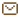</picture> <a href="mailto:dev.miko@icloud.com">Email</a>

## <picture><source media="(prefers-color-scheme: dark)" srcset="./assets/icons/aligned/coffee-section-dark.svg"></picture> About me

I'm a software developer working with Swift and Python. I focus on native applications, developer tools, and automation.

## <picture><source media="(prefers-color-scheme: dark)" srcset="./assets/icons/aligned/keyboard-section-dark.svg">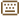</picture> My toolbox

<picture><source media="(prefers-color-scheme: dark)" srcset="./assets/icons/aligned/swift-stack-dark.svg"></picture> <strong>Swift</strong> &nbsp;&nbsp; <picture><source media="(prefers-color-scheme: dark)" srcset="./assets/icons/aligned/python-stack-dark.svg">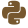</picture> <strong>Python</strong> &nbsp;&nbsp; <picture><source media="(prefers-color-scheme: dark)" srcset="./assets/icons/aligned/postgresql-stack-dark.svg">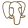</picture> <strong>PostgreSQL</strong> &nbsp;&nbsp; <picture><source media="(prefers-color-scheme: dark)" srcset="./assets/icons/aligned/git-stack-dark.svg">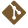</picture> <strong>Git</strong> &nbsp;&nbsp; <picture><source media="(prefers-color-scheme: dark)" srcset="./assets/icons/aligned/docker-stack-dark.svg">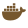</picture> <strong>Docker</strong>

<table>
<thead><tr><th align="left">Area</th><th align="left">What I work with</th></tr></thead>
<tbody>
<tr><td><picture><source media="(prefers-color-scheme: dark)" srcset="./assets/icons/aligned/code-area-dark.svg">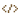</picture> <strong>Languages</strong></td><td>Swift · Python · Objective-C · SQL</td></tr>
<tr><td><picture><source media="(prefers-color-scheme: dark)" srcset="./assets/icons/aligned/apple-area-dark.svg">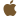</picture> <strong>Native apps</strong></td><td>SwiftUI · UIKit · Xcode iOS · iPadOS · macOS · watchOS · visionOS</td></tr>
<tr><td><picture><source media="(prefers-color-scheme: dark)" srcset="./assets/icons/aligned/sqlite-area-dark.svg"></picture> <strong>Databases</strong></td><td>PostgreSQL · MySQL · SQLite</td></tr>
<tr><td><picture><source media="(prefers-color-scheme: dark)" srcset="./assets/icons/aligned/githubactions-area-dark.svg">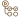</picture> <strong>Automation & workflow</strong></td><td>Python automation · AI workflows Git · GitHub · GitHub Actions · Docker</td></tr>
<tr><td><picture><source media="(prefers-color-scheme: dark)" srcset="./assets/icons/aligned/xcode-area-dark.svg">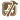</picture> <strong>Design & delivery</strong></td><td>SF Symbols · Apple HIG · TestFlight</td></tr>
</tbody>
</table>

<a href="https://github.com/mikonyaa?tab=repositories">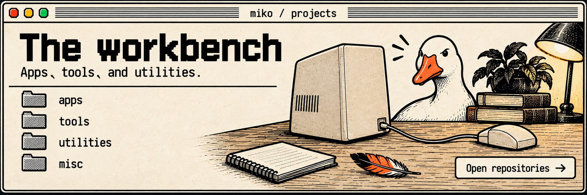</a>

## <picture><source media="(prefers-color-scheme: dark)" srcset="./assets/icons/aligned/folder-section-dark.svg"></picture> Projects on the desk

<table><tbody><tr><td width="50%" valign="top"><h3><picture><source media="(prefers-color-scheme: dark)" srcset="./assets/icons/aligned/terminal-project-dark.svg">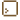</picture> <a href="https://github.com/mikonyaa/fontwitness">FontWitness</a></h3>
CLI · font checks

<a href="https://github.com/mikonyaa/fontwitness">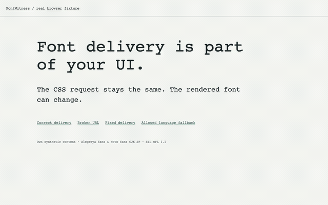</a>

Shows which fonts Chromium actually used and checks them against the expected ones.
<ul><li>Reports you can open offline</li><li>Font checks that can fail a CI build</li></ul>
<a href="https://github.com/mikonyaa/fontwitness">Repository →</a> &nbsp; · &nbsp; <a href="https://github.com/mikonyaa/fontwitness/blob/main/README.md">How it works</a>
</td><td width="50%" valign="top"><h3><picture><source media="(prefers-color-scheme: dark)" srcset="./assets/icons/aligned/code-project-dark.svg">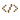</picture> <a href="https://github.com/mikonyaa/ResizeLint">ResizeLint</a></h3>
Swift · static analysis

Checks Swift source for UIKit layout code that can break when a window is resized.
<ul><li>9 layout rules, with suggested fixes</li><li>Xcode messages, JSON, and SARIF output</li></ul>
<a href="https://github.com/mikonyaa/ResizeLint">Repository →</a> &nbsp; · &nbsp; <a href="https://github.com/mikonyaa/ResizeLint/blob/main/Docs/Rules/README.md">Browse rules</a>
</td></tr><tr><td width="50%" valign="top"><h3><picture><source media="(prefers-color-scheme: dark)" srcset="./assets/icons/aligned/keyboard-project-dark.svg">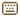</picture> <a href="https://github.com/mikonyaa/MacMenuBarCommandKit">Menu Bar Command Kit</a></h3>
SwiftUI · macOS

<a href="https://github.com/mikonyaa/MacMenuBarCommandKit">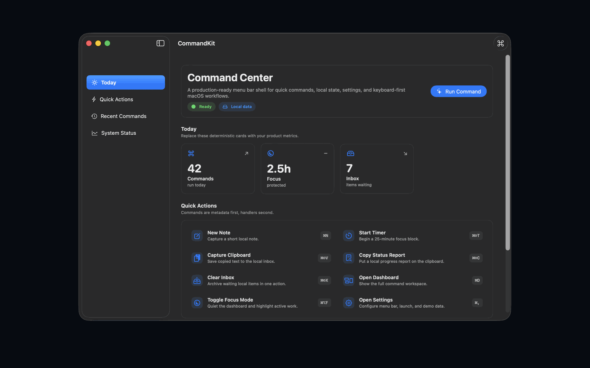</a>

SwiftUI kit for a macOS app with a main window, menu bar controls, and a command palette.
<ul><li>Search commands and navigate with the keyboard</li><li>Settings and Launch at Login</li></ul>
<a href="https://github.com/mikonyaa/MacMenuBarCommandKit">Repository →</a> &nbsp; · &nbsp; <a href="https://github.com/mikonyaa/MacMenuBarCommandKit/blob/main/README.md">Demo guide</a>
</td><td width="50%" valign="top"><h3><picture><source media="(prefers-color-scheme: dark)" srcset="./assets/icons/aligned/folder-project-dark.svg"></picture> <a href="https://github.com/mikonyaa/AdaptiveAppShell">Adaptive App Shell</a></h3>
SwiftUI · iPhone and iPad

<a href="https://github.com/mikonyaa/AdaptiveAppShell">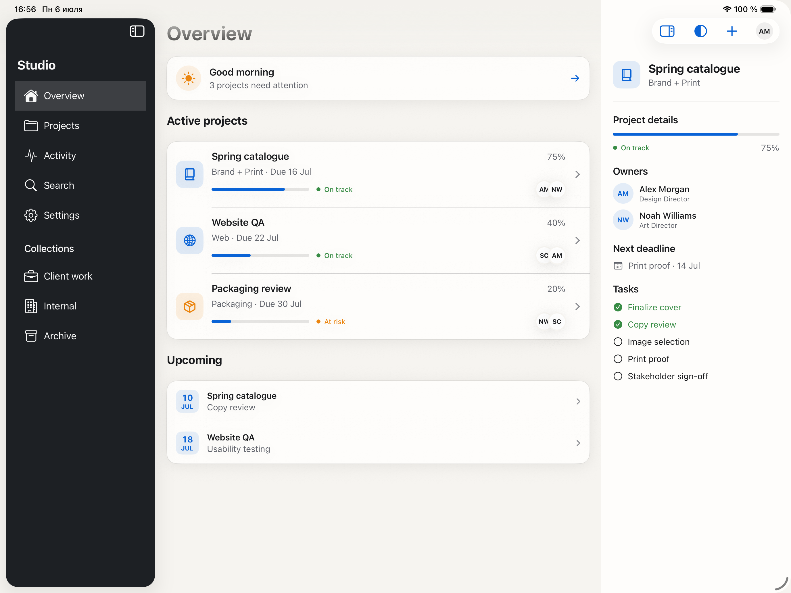</a>

SwiftUI app shell with tabs on iPhone and a sidebar on iPad.
<ul><li>Separate navigation paths and support for deep links</li><li>Optional inspector and accessible themes</li></ul>
<a href="https://github.com/mikonyaa/AdaptiveAppShell">Repository →</a> &nbsp; · &nbsp; <a href="https://github.com/mikonyaa/AdaptiveAppShell/blob/main/README.md">Integration notes</a>
</td></tr></tbody></table>

Previews are from the repositories: demo GIFs with sample data, a ResizeLint terminal example, and an Adaptive App Shell simulator screenshot.

### More on the shelf

<table>
<thead><tr><th align="left">Repository</th><th align="left">What's inside</th></tr></thead>
<tbody>
<tr><td><picture><source media="(prefers-color-scheme: dark)" srcset="./assets/icons/aligned/folder-shelf-dark.svg"></picture> <a href="https://github.com/mikonyaa/LiquidGlassTabBars">Liquid Glass Tab Bars</a></td><td>Three tab bar patterns: system, floating, and morphing. Includes accessibility fallbacks.</td></tr>
<tr><td><picture><source media="(prefers-color-scheme: dark)" srcset="./assets/icons/aligned/terminal-shelf-dark.svg">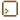</picture> <a href="https://github.com/mikonyaa/LiveActivityDynamicIslandKit">Live Activity & Dynamic Island Kit</a></td><td>Live Activity layouts for the Lock Screen and Dynamic Island, plus a demo for updating and ending them.</td></tr>
<tr><td><picture><source media="(prefers-color-scheme: dark)" srcset="./assets/icons/aligned/github-shelf-dark.svg">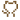</picture> <a href="https://github.com/mikonyaa/Apple-Design-Templates">Apple Design Templates</a></td><td>An index of four SwiftUI kits, with examples and setup notes.</td></tr>
</tbody>
</table>

[Browse every repository →](https://github.com/mikonyaa?tab=repositories)

---

 The goose is not on the payroll.

