<!--
  miko in Xcode. Everything in assets/profile/ is drawn by scripts/profile/build.py;
  .github/workflows/profile.yml redraws the live numbers twice a day.
-->


  
  
  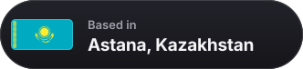

## About

I'm a software developer working with Swift and Python. I build native apps for Apple platforms, developer tools that catch problems before users do, and small automations so I don't have to do the same thing twice.
On the server side I write APIs with Vapor and FastAPI.

Lately that means SwiftUI kits and command-line checks that run in CI.

## Projects

  <a href="https://github.com/mikonyaa/Apple-Design-Templates"></a>
  <a href="https://github.com/mikonyaa/LiquidGlassTabBars"></a>
  <a href="https://github.com/mikonyaa/AdaptiveAppShell"></a>
  <a href="https://github.com/mikonyaa/MacMenuBarCommandKit"></a>
  <a href="https://github.com/mikonyaa/ResizeLint"></a>
  <a href="https://github.com/mikonyaa/fontwitness"></a>

<b>More on the shelf</b>

 

**Apple platform kits**
- [Live Activity & Dynamic Island Kit](https://github.com/mikonyaa/LiveActivityDynamicIslandKit) · ActivityKit and Dynamic Island template with a real WidgetKit demo
- [nativecraft-verify](https://github.com/mikonyaa/nativecraft-verify) · an inspectable XCTest recipe for SwiftUI preferences

**Testing and developer tools**
- [skillparcel](https://github.com/mikonyaa/skillparcel) · test what Claude Code actually loads from skill contracts
- [mcpclientcanary](https://github.com/mikonyaa/mcpclientcanary) · reproduce MCP client state regressions with evidence
- [tracesharegate](https://github.com/mikonyaa/tracesharegate) · minimal debugging reports from Playwright traces
- [chronocases](https://github.com/mikonyaa/chronocases) · regression cases for dates, timezones and recurring schedules
- [slidetransit](https://github.com/mikonyaa/slidetransit) · compare presentation exports and find delivery regressions
- [originrehearsal](https://github.com/mikonyaa/originrehearsal) · rehearse web-app upgrades with retained browser profiles
- [cuereviewkit](https://github.com/mikonyaa/cuereviewkit) · review source and translated subtitles before delivery

**Everything else**
- [lessonroutes](https://github.com/mikonyaa/lessonroutes) · turn screenshots into small branching practice lessons
- [roundrelay](https://github.com/mikonyaa/roundrelay) · run workshop rounds and repair groups when attendance changes
- [homebrew-tap](https://github.com/mikonyaa/homebrew-tap) · the Homebrew tap for ResizeLint

<b>Demos</b> · recordings from the repositories

 
<table>
  <tr>
    <td width="50%"><a href="https://github.com/mikonyaa/fontwitness">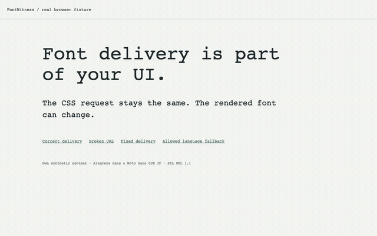</a> <b>FontWitness</b> · an audit before and after a fix</td>
    <td width="50%"><a href="https://github.com/mikonyaa/MacMenuBarCommandKit">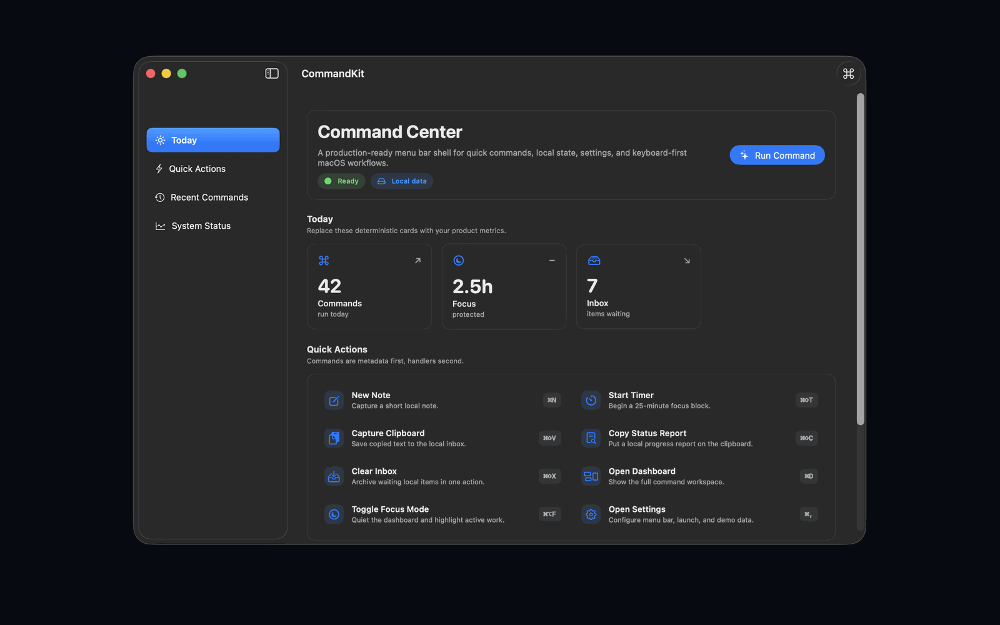</a> <b>Menu Bar Command Kit</b> · workspace, palette, settings</td>
  </tr>
  <tr>
    <td width="50%"><a href="https://github.com/mikonyaa/ResizeLint">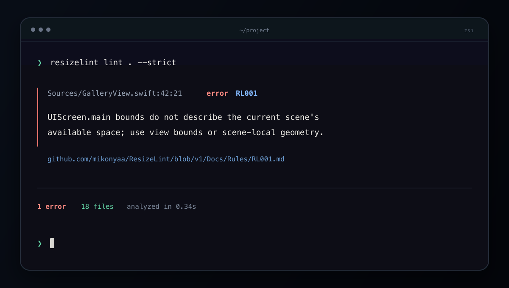</a> <b>ResizeLint</b> · a layout finding and its fix</td>
    <td width="50%"><a href="https://github.com/mikonyaa/AdaptiveAppShell">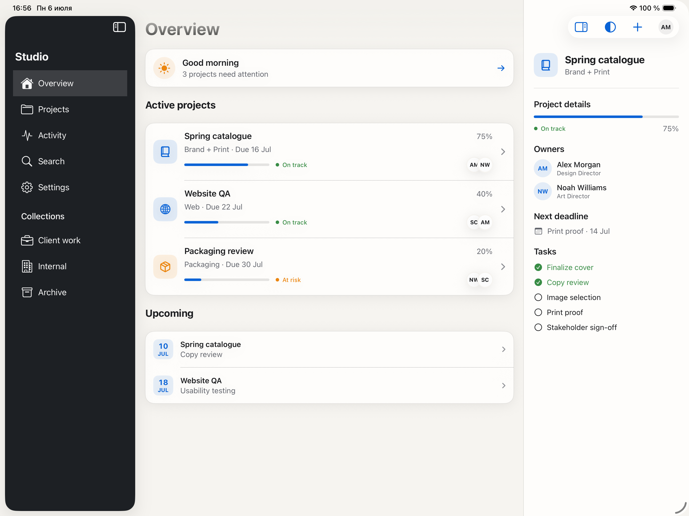</a> <b>Adaptive App Shell</b> · iPad sidebar and inspector</td>
  </tr>
</table>


## Stack


## Activity


